  

**Liang Chen**  
Co-founder & COO at **SiliconProspect AI**

Turning research into products. Building organizations that deliver.

[**Explore my website**](https://wanmo8908.github.io/) · [Experience & Education](https://wanmo8908.github.io/#journey) · [Research Highlights](https://wanmo8908.github.io/#research)

---

### Background

I hold bachelor's and master's degrees in Management Science and Engineering from Renmin University of China. At SiliconProspect AI, I work across company operations, financing and commercialization, connecting AI research with products and real-world needs.

| Date | Milestone |
| --- | --- |
| 2007 | Began bachelor's studies in Management Science and Engineering at Renmin University of China |
| 2011 | Began master's studies in Management Science and Engineering at Renmin University of China |
| Jul 2013 | Joined the China Securities Regulatory Commission (CSRC) |
| Jan 2019 | Joined Hillhouse Capital |
| Aug 2023 | Joined Aegon-Industrial Fund Management (Xingquan) |

### What I care about

- **Company building** — Aligning goals, resources and teams so exploration leads to consistent delivery.
- **Research to reality** — Starting with real needs and connecting research, product value and sustainable business.
- **Trustworthy AI** — Exploring how interpretability can help AI users understand risks, improve quality and use resources more efficiently.

### Building with research

Working with research partners to bring trustworthy AI into practice: [Jie Zhang's research](https://zjzac.github.io/) · [Han Qiu's academic website](https://qiuhan.info/).

### Let's connect

Open to conversations about AI products, trustworthy AI and research commercialization.  
Find me on [GitHub · @wanmo8908](https://github.com/wanmo8908).
